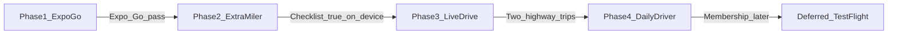

# November ship queue — Expo Go personal MVP

Original October target was TestFlight by **31 Oct 2026**. That is **deferred** until a paid Apple Developer membership is renewed on purpose (~$99/yr).

**Official ship bar now:** Expo Go on a real iPhone — plan → navigate/record → Travel Log, then extra-miler honesty on live drives.

**Active master list:** [docs/TASKS.md](../TASKS.md)

Reliability evidence still lives in [MVP Release Gate](../MVP_RELEASE_GATE.md). Gate is FAIL until navigation-while-moving, background, and offline are proven on device (Expo Go caveats noted on the gate / TASKS).

## Boards

- [Phase 1 — Expo Go personal MVP](./phase-1-install.md) (**active**)
- [Phase 2 — Extra-miler truth](./phase-2-extra-miler.md)
- [Phase 3 — Live like the user](./phase-3-live-drive.md)
- [Phase 4 — Ship what you drove](./phase-4-ship.md)

## Now (2026-11-04 evening CT)

**Phase 1 — Expo Go.** Continuation branch `cursor/november-mvp-continuation-7c25` has the October stack, PR #2 fixes, Loop/FM stay-on ranking, and offline Retry UX.

Your next moves:

1. Gemini API key (Maps key already set up with the right APIs)
2. Local `.env` with both `EXPO_PUBLIC_*` keys
3. `npx expo start` → Expo Go → device-pass checklist on Phase 1

Then Phase 2 on real drives. TestFlight stays parked under Deferred in TASKS.

## Out of this queue

Paid Apple membership / TestFlight / App Review (until you opt in), bookings, Tesla 3D renderer, CarPlay, national camera completeness, “new miles” chips, RPG, social, Checklist / Travel Log visual rewrite.
