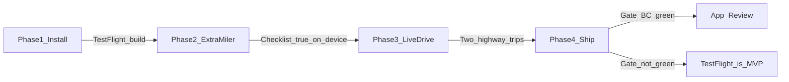

# November ship queue (continued from October MVP)

Original target was TestFlight by **31 Oct 2026**. That window passed with Phase 1 still blocked on Expo project link, Apple credentials, and Maps/Gemini env keys.

**Active master list:** [docs/TASKS.md](../TASKS.md)

This folder remains the phase boards. Reliability evidence still lives in [MVP Release Gate](../MVP_RELEASE_GATE.md). Gate is FAIL until navigation-while-moving, background, and offline are proven on device.

## Boards

- [Phase 1 — Installable](./phase-1-install.md) (still the active blocker)
- [Phase 2 — Extra-miler truth](./phase-2-extra-miler.md)
- [Phase 3 — Live like the user](./phase-3-live-drive.md)
- [Phase 4 — Ship what you drove](./phase-4-ship.md)

## Now (2026-11-05)

**Phase 1 — in progress.** Continuation branch `cursor/november-mvp-continuation-7c25` includes the October stack **plus** the missing Aug 31 core-loop bugfixes (PR #2), Loop/FM stay-on ranking, and recoverable offline route errors.

Done in this continuation:

- Linked EAS project `adc0e18c-6f98-4d6c-8dec-f688c46f5bc9` (`@theimprovisedpixel/Nomad`)
- `npm test` / `test:smoke` / `test:phase1` green

Still blocked on you:

1. Create `EXPO_PUBLIC_GOOGLE_MAPS_API_KEY` + `EXPO_PUBLIC_GEMINI_API_KEY` on expo.dev → Project → Environment variables → **production** (and preview)
2. Interactive Apple credentials: `npx eas-cli credentials` / first `eas build` in interactive mode for `com.nomadlabstx.nomad`
3. App Store Connect app + `eas.json` submit fields (`appleId`, `appleTeamId`, `ascAppId`)
4. Optional: GitHub secret `EXPO_TOKEN` for the TestFlight workflow

Then: `npm run eas:testflight` and run the Phase 1 device pass checklist.

## Out of this queue

Bookings, Tesla 3D renderer, CarPlay, national camera completeness, “new miles” chips, RPG, social, Checklist / Travel Log visual rewrite.
